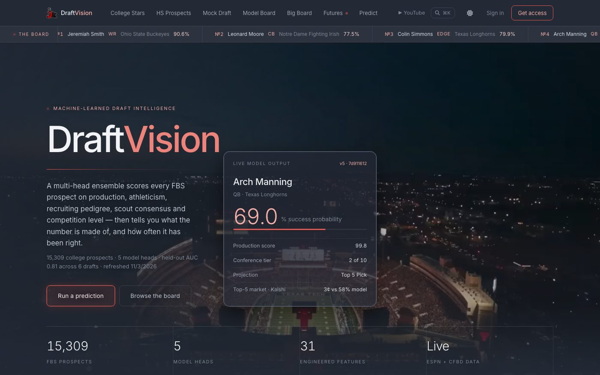
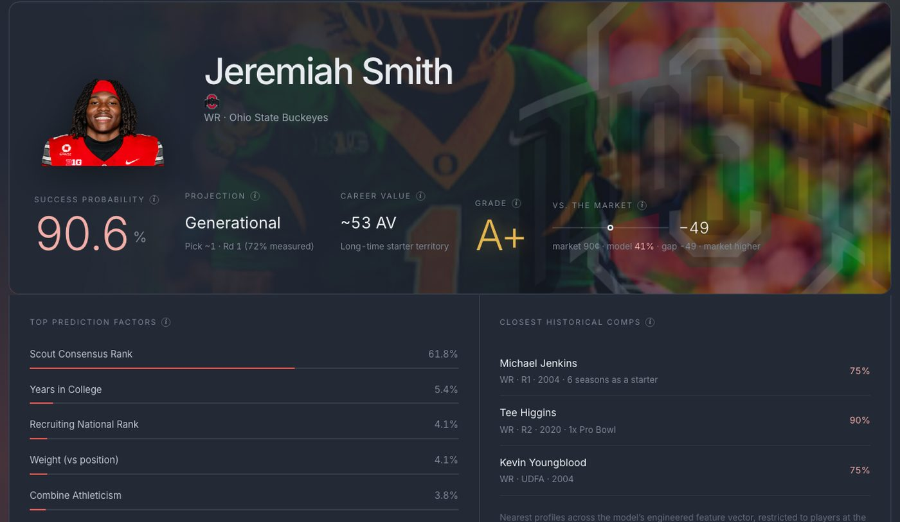
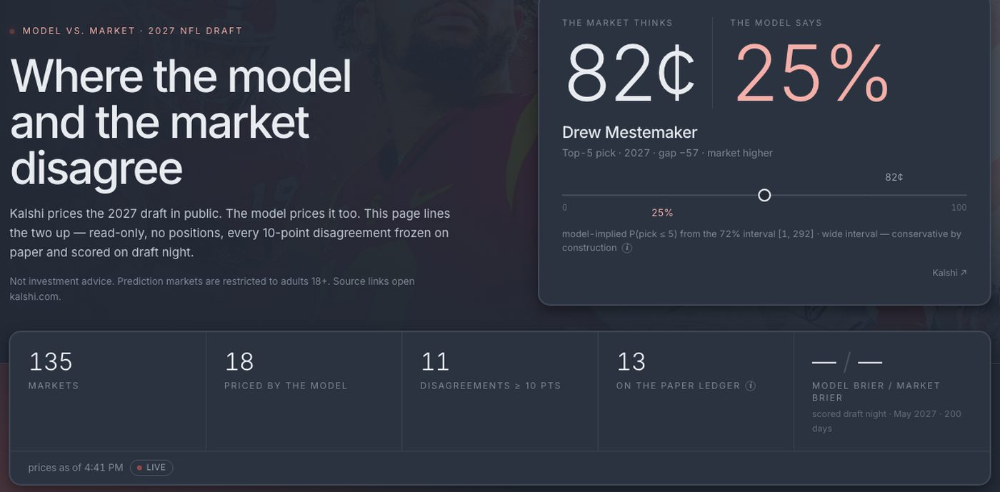
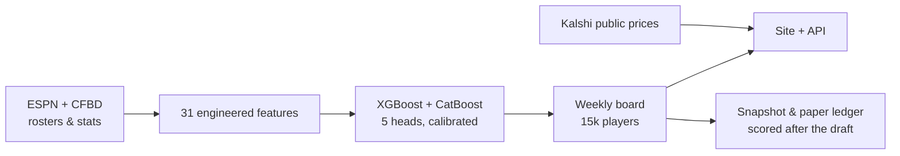

<div align="center">

# DraftVision

**A machine-learning draft board for college football — and a public record of how often it's right.**

[**draft.jkrek.com**](https://draft.jkrek.com) · built by [Jared Krekeler](https://github.com/Jkrek) · [JK Football on YouTube](https://www.youtube.com/@jkrek)

[](https://github.com/Jkrek/DraftVision/actions/workflows/tests.yml)
[](https://github.com/Jkrek/DraftVision/actions/workflows/refresh-board.yml)



</div>

## What it does

Type any FBS player and the model tells you the odds he becomes an NFL starter, where he'd go in the draft, what his career might be worth, and *why* — the features that moved the number and the real NFL players he most resembles.

- **15,000+ college prospects** graded every Tuesday from live ESPN and College Football Data stats, plus the high-school recruiting classes.
- **Five model heads, one report** — success probability, draft grade, projected pick with an honest range, career value, and a Generational / Top-5 / Round ladder.
- **Model vs. market** — Kalshi's 2027 draft futures lined up against the model, every disagreement frozen on a paper ledger and scored on draft night. Read-only; no positions.
- **Receipts** — a backtest page that scores the model on draft classes it never saw, against the consensus big board, with every row downloadable.

<p align="center">
  
  
</p>

## How good is it

Measured on the 2019–2020 draft classes, which were held out of training entirely, and re-checked across six rolling-origin folds (2015–2020) so one lucky holdout can't flatter it.

| | Held-out 2019–20 | Six drafts (mean ± std) |
|---|---|---|
| Success AUC | 0.81 | 0.83 ± 0.03 |
| Draft-grade accuracy (4 buckets) | 65% | 65% ± 1% |
| Pick error, drafted players | 36 picks | 36 ± 2 |
| First-rounders flagged by pick 45 | 84% | 90% ± 5% |

The honest version: on the few hundred players the consensus big board ranks, the model roughly ties the scouts (0.82 vs 0.81 AUC). Its value is covering 15,000 players instead of 300, with calibrated probabilities and ranges — not out-scouting the scouts on the names everyone already knows. Every number above is served live at [`/api/model-info`](https://draft.jkrek.com/api/model-info) and shown on the [backtest page](https://draft.jkrek.com/backtest).

## How it works



- **Features** — production (final season and career), combine athleticism, recruiting pedigree, scout consensus rank, team strength, and an age proxy. In-season stats are shrunk toward the prior season so one big game doesn't move a player 9,000 spots.
- **Models** — XGBoost and CatBoost members averaged, then calibrated on a separate year. A rule-based baseline has to lose on the holdout before the ensemble is allowed to serve.
- **Pipeline** — a GitHub Action rebuilds the board every Tuesday: tests → boot the API → score every player → post-process → commit the snapshot → deploy. A broken test can't ship a board.
- **Honesty guards** — leakage checks on every feature, a no-feature-only-on-seed-rows rule (that one bit us), and any model change must win across the six folds, not one.

## Run it

```bash
# 1. Python API (serves the built React app)
pip install -r requirements.txt
npm ci && npm run build
python XGBOost.py            # → http://localhost:5001

# 2. Optional: live keys in .env (the committed caches work without them)
CFBD_API_KEY=...             # recruiting classes + enrichment
```

```bash
# Retrain and re-evaluate (the models in the repo are the current production fit)
python scripts/train_models.py       # train, evaluate on the holdout, gate, write metadata
python scripts/rolling_cv.py         # six-fold rolling-origin check
python scripts/generate_backtest.py  # regenerate the backtest page's receipts
python tests/test_edge_parsing.py    # regression suite (also runs in CI)
```

Deployment, secrets, and the weekly refresh are documented in [`DEPLOY.md`](DEPLOY.md).

## Layout

```
XGBOost.py              Flask API + model serving
dv_edge.py              Kalshi market board, paper ledger, scoring
dv_features.py          feature definitions shared by training and serving
scripts/                train_models, rolling_cv, generate_backtest, postprocess_board
build_prospect_cache.py weekly board builder
src/                    React app (Nocturne design system)
training_data/          training CSV, weekly board, snapshots, ledger
models/                 metadata, feature stats, experiment results
tests/                  fixture-driven regression suite
```

## Built with

React 18 · Flask · XGBoost · CatBoost · scikit-learn · Postgres · Docker · Fly.io · GitHub Actions
Data from ESPN and [CollegeFootballData](https://collegefootballdata.com); market prices from Kalshi's public API.

---

<sub>Started as a Computer Science senior design project at the University of Cincinnati. Not affiliated with the NFL, any team, or Kalshi. Market data is analysis only — DraftVision takes no positions and is not investment advice.</sub>
